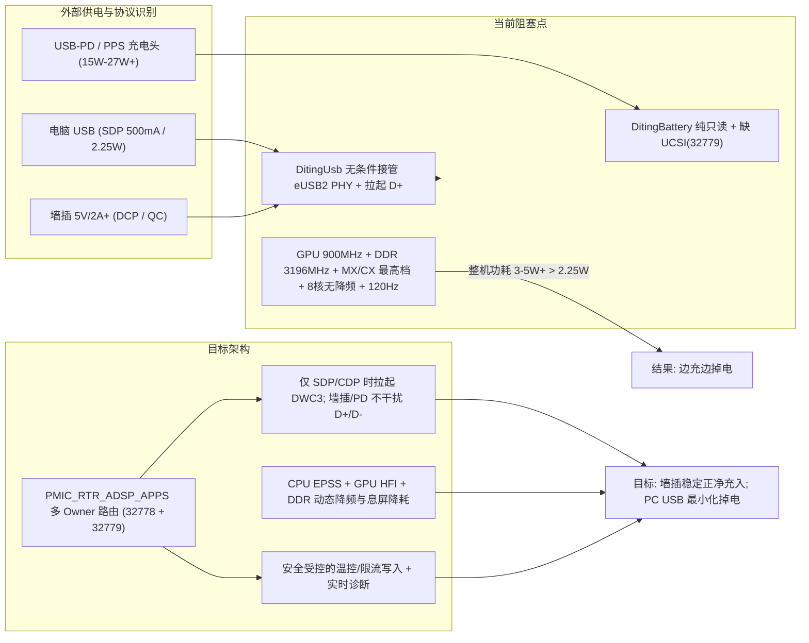

# UniXNU-diting（iOS 27 / SM8475）系统内充电与功耗治理实现计划

> [!IMPORTANT]
> 本计划针对 **Redmi K50 至尊版（`diting` / SM8475）** 运行 UniXNU iOS 27.2.1（`24B156`）时“系统内边插线边掉电 / 无法正常充入电量”的问题，给出从**立即可见效的防冲突与可观测性修复**到**整机功耗下降**与**完整 PMIC GLINK / USB-C PD 充电控制**的分阶段实现方案。

---

## 1. 实测基线与硬件拓扑

### 1.1 当前实测问题基线（`boot-ios27-gpu-freshdata5-112`）

| 观测项 | 实测值 | 来源 / 说明 |
| --- | --- | --- |
| ADSP / 电池服务 | `ADSP stage=13`, `DitingBattery stage=4` | `adsp.mbn` 与 `PMIC_RTR_ADSP_APPS` 正常在线 |
| 外部供电与状态 | `BmUsbOnline=1`, `BmStatus=1 (Charging)`, `BmChargeType=3` | PMIC 硬件**已在尝试充电**，并非关闭充电 |
| 端口识别与输入限流 | `BmUsbType=1 (SDP)`, `BmUsbLimit=500 mA`, `BmUsbMax=500 mA` | 接电脑 USB 时被锁在 SDP 500 mA |
| 输入电压与功率 | `VBUS=4490 mV`, `BmUsbCurrent=500 mA`（`~2.25 W`） | 压降接近 4.5 V 限流门槛 |
| 电池净电流（黑屏低载） | `BmCurrent=-15000 µA` → `+15 ~ +30 mA`（充电为正） | 勉强与黑屏空转打平；亮屏/GPU/Wi-Fi 立即转为净放电 |
| 电池容量与温度 | `3650 mV`, `37.4–38.4°C`, `1% → 0%` 掉进 fastboot | 长期满血运行导致入不敷出 |
| AP 侧充电控制写入 | `legacy_writes=0`（纯只读） | [DitingBattery.cpp](../../drivers/DitingPower/DitingBattery.cpp#L5) |

### 1.2 真机充电与 USB 硬件拓扑（基于 `live.dtb` 与现有驱动）

- **充电与电量计芯片**：PM8350B 主充 + 双 `smb139x`（`smb1394`）电荷泵，由 ADSP 保护域 `msm/adsp/charger_pd` 托管，经 GLINK 通道 `PMIC_RTR_ADSP_APPS` 与 AP 通信：
  - `owner = 32778`：`qcom,battery-charger`（电池与 USB 充电属性，当前仅实现只读）
  - `owner = 32779`：`qcom,ucsi-glink`（Type-C 端口状态、数据/供电角色、USB-PD 协商，**当前未实现**）
  - `owner = 32782`：`qcom,altmode-glink`（Type-C Altmode，当前未实现）
- **USB 物理链路**：`snps,dwc3`（`0x0a600000`）+ `eUSB2 PHY`（`0x088e3000`）+ QUP5 I2C 上的 `nxp,eusb2-repeater`（`0x4f`）与 `qcom,fsa4480-i2c`。

---

## 2. 分阶段实施路线

| 阶段 | 核心目标 | 预期效果 | 依赖 |
| --- | --- | --- | --- |
| **Phase 0** | 充电可观测性 + 解除 `DitingUsb` 对充电头识别的干扰 + 修正 `bMaxPower` | 插墙插 5V/2A+ 充电头不再被退回 500 mA，可通过一行命令实时查看充电电流/协议/限流 | 无（可立即开展） |
| **Phase 1** | 整机降功耗（GPU/DDR/电压角解绑满血 + iOS 27 CPU 动态调频 + 息屏降耗） | 系统空载与亮屏基础功耗大幅下降，5V/2A（10 W）即可稳定正向涨电，插电脑显著减缓掉电 | Phase 0 |
| **Phase 2** | `PMIC_RTR_ADSP_APPS` 多 Owner 路由 + UCSI (`32779`) + 受控温控/限流写入 | USB 角色完全由 Type-C/UCSI 驱动，充电温控与限流策略安全可控 | Phase 0 |
| **Phase 3** | 高功率 USB-PD / PPS 与小米 `smb139x` 快充评估 + iOS 电源 UI / 低电关机联调 | 稳定支持 15–27 W+ 快充（视 ADSP 自主协商结果决定是否引入电荷泵控制），低电干净关机 | Phase 1 & 2 |

---

## 3. 详细实现内容

### Phase 0：可观测性与 USB 充电防冲突（优先落地）

#### 0.1 增加 `battery` / `charger` 实时诊断命令
- **涉及文件**：
  - [DitingBattery.cpp](../../drivers/DitingPower/DitingBattery.cpp)
  - [DitingUsbDevice.h](../../drivers/DitingUsb/DitingUsbDevice.h#L149-L235)
- **实现内容**：
  1. 在 `DitingBattery.cpp` 导出弱符号接口 `extern "C" unsigned diting_battery_snapshot_text(char *out, unsigned capacity)`，格式化输出单次完整快照：
     - 电池侧：`percent`、`voltage_mv`、`current_ma`（明确标注充电为正）、`temp_0p01c`、`raw_mah`/`full_mah`/`design_mah`、`cycles`、`flags`、`stale`、`cycles_done`/`errors`/`timeouts`
     - 充电器侧：`usb_online`、`usb_type`、`usb_adapter`、`real_type`、`usb_limit_ma`、`usb_max_ma`、`vbus_mv`、`ibus_ma`、`status`、`charge_type`、`thermal_level`、`fcc_ma`、`watts`、`writes`
  2. 在 `DitingUsb::input()` 新增 `battery` 命令分支，并在 `help` 文本中列出。
  3. 在 `DitingBattery::publish()` 检测到 `BmUsbType`、`BmRealType`、`BmUsbLimit` 变化或 `current_ma` 跨零（充/放电切换）时输出一行精简 `IOLog`（同步落入 ramoops 环形日志），用于插**墙插充电头**（无电脑 USB 连接）后事后回读验证。

#### 0.2 修复 `DitingUsb` 无条件占用 eUSB2 PHY / 拉起 D+ 的冲突
- **涉及文件**：
  - [DitingBattery.cpp](../../drivers/DitingPower/DitingBattery.cpp#L36-L39) 及 [L165-L166](../../drivers/DitingPower/DitingBattery.cpp#L165-L166)
  - [DitingUsbDevice.h](../../drivers/DitingUsb/DitingUsbDevice.h#L57-L64) 及 [L608-L640](../../drivers/DitingUsb/DitingUsbDevice.h#L608-L640)
  - [DitingUsbPhy.h](../../drivers/DitingUsb/DitingUsbPhy.h#L91-L196)
- **问题根因**：
  - 当前只要 `s.external == 1`（任何 5V 输入，含纯充电头），`diting_battery_usb_online()` 就返回 `1`；而且在 `DITING_GUEST_24B156` 下 `cableOnline()` 将未知状态（`< 0`）也强行当作 `1`。
  - 这导致插上墙插头时，`DitingUsb` 仍初始化 eUSB2 PHY / NXP repeater、置位 `QSCRATCH` VBUS override 并置位 `DWC3_DCTL_RUN_STOP`（拉起 D+），干扰 PM8350B 的 BC1.2（APSD）/ QC / 私有快充协议识别。
- **实现内容**：
  1. 在 `DitingBattery` 中区分“外部供电”与“数据主机连接”，新增接口 `extern "C" int diting_battery_usb_data_online(void)`：
     - 依据最新有效快照中的 `BmUsbType` / `BmUsbAdapter` / `BmRealType` 判定：
       - `SDP`（`1`）或 `CDP`（`2`）→ 返回 `1`（允许 DWC3 进入 Device 模式枚举）
       - `DCP`、`HVDCP`、`PD` 等纯充电适配器 → 返回 `0`（禁止拉起 `RUN_STOP`）
       - 尚未读到有效端口类型 → 返回 `-1`（等待 ADSP 完成 APSD 检测）
  2. 修改 `DitingUsb::worker()` 与 `cableSession()` 的启动与附着时序：
     - 拔出或确认为纯充电头时，确保清除 `DWC3_DCTL_RUN_STOP` 与 `QSCRATCH` VBUS override，不抢占 D+/D-。
     - 冷启动插线场景下，若 `diting_adsp=2` 已启用，先等待有限窗口（如 3–5 秒）让 ADSP/Battmgr 上报真实端口类型；仅当检测到 SDP/CDP 时才执行 `prepareBoardPhy()` / `RUN_STOP`。
     - 新增调试兜底 boot-arg `diting_usb_force=1`（默认 `0`）：在 ADSP 未启用或调试必须强制带起 USB 控制台时保留原行为，确保不会把调试口锁死。

#### 0.3 修正 USB 配置描述符的 `bMaxPower`
- **涉及文件**：[DitingUsbDevice.h](../../drivers/DitingUsb/DitingUsbDevice.h#L116-L128)
- **实现内容**：
  - 将 `config[]`（第 8 字节）和 `composite[]`（第 8 字节）的 `bMaxPower` 由 `50`（100 mA）修改为 `250`（**500 mA**，USB 2.0 规范最大声明值）。
  - 同步确认 `bmAttributes`（`0xc0` 保留自供电标记或按主机策略调整，确保 Linux/macOS 主机及 USB Hub 分配满额 500 mA 预算而不报错）。

---

### Phase 1：整机功耗治理（解决“入不敷出”）

#### 1.1 解除 GPU / `mx` / `cx` 永久锁满血，接入动态 GPU 调频
- **涉及文件**：
  - [DitingAdrenoPlatform.cpp](../../drivers/DitingAdreno/DitingAdrenoPlatform.cpp#L104-L129) 及 [L292-L355](../../drivers/DitingAdreno/DitingAdrenoPlatform.cpp#L292-L355)
  - [DitingAdrenoGmu.h](../../drivers/DitingAdreno/DitingAdrenoGmu.h)、[DitingAdrenoGmu.c](../../drivers/DitingAdreno/DitingAdrenoGmu.c#L228-L267)
  - [DitingAdrenoPowerProfile.h](../../drivers/DitingAdreno/DitingAdrenoPowerProfile.h#L2-L16)
- **实现内容**：
  1. 将 `DITING_GUEST_24B156` 下 `diting_gpu_lock_max` 默认值改为 `0`（保留 `diting_gpu_lock_max=1` 给性能基准测试），启动起步档从 `power_level=0`（900 MHz）调整为中低档（如 level 9–12，220–364 MHz）。
  2. 在 `DitingAdrenoGmu.c` 新增运行时调频接口 `DitingAdrenoGmuSetPowerLevel(DitingGpuGmuDevice *d, unsigned power_level)`：在独立互斥锁保护下复用已验证的 HFI command ID `30`（`{1, tables.gpu_index, tables.bus_index}`）并等待 ACK，在 13 个真实 DT 档位（220 MHz ~ 900 MHz）间无毛刺切换。
  3. 参考 `UniXNU/docs/porting/power.md`（L202-L208）增加轻量 GPU DCVS 线程：
     - 根据近期帧提交计数 / GMU 忙周期与触控 boost 信号动态升降频；
     - 连续空闲窗口或息屏状态自动回落到最低档（220 MHz + 最低可用 DDR 带宽档）。
  4. 在 [DitingPlatformResources.cpp](../../drivers/DitingPower/DitingPlatformResources.cpp) 补齐共享 RPMh 消费者聚合计数（GPU / ADSP / WLAN / USB），消除 `vote_parents()` 把 `mx.lvl`、`cx.lvl` 永久顶在最高 AUX 电压角的做法。

#### 1.2 DDR / LLCC 带宽按需投票，不再永久锁 3196 / 1066 MHz
- **涉及文件**：
  - [DitingMemoryBandwidth.cpp](../../drivers/DitingPower/DitingMemoryBandwidth.cpp#L126-L159)
  - [DitingMemoryPolicy.h](../../drivers/DitingPower/DitingMemoryPolicy.h#L11)
- **实现内容**：
  1. 在 `DitingMemoryPolicy.h` 定义多档合法 DDR / LLCC 频率表（Idle / Display / Active / Max），均通过 `command-db` 的真实 `MC3`/`SH5` 单位换算。
  2. 暴露 `diting_memory_bandwidth_set_profile(unsigned level)`，由 GPU 活跃度、触控 boost 与息屏状态联动切换；息屏/静止画面回落至低档，保留 `diting_memory_bw=0` 关闭或 `diting_memory_bw=2` 锁满血的调试选项。

#### 1.3 为 iOS 27 接入 SM8475 EPSS CPU 动态调频（负载感知模式）
- **涉及文件**：
  - 复用参考：[DitingCpuPolicy.h](../../drivers/ArmCpu/DitingCpuPolicy.h)
  - 构建集成：[build-diting-ios27-drivers.py](../../scripts/build-diting-ios27-drivers.py)、[board.toml](../../board.toml#L265-L284)
- **实现内容**：
  1. 在 iOS 27 的 `ArmCpu` 或 XNU 补丁中导出 8 核调度器空闲时间读取函数 `diting_cpu_idle_mach(unsigned cpu)`。
  2. 将 `DitingCpuPolicy` 接入 iOS 27 启动流程，并将默认模式从 `mode=2`（固定锁三簇最高频 1.80 / 2.50 / 3.00 GHz）改为 **`diting_cpu_policy=1`**（32 ms 采样，1.25× 负载裕量，4 窗口低载逐级降频，保留 EPSS/LMh 硬件温控限频）。
  3. 新增 `cpu` 诊断命令（或在 `battery` / `power` 输出中附带三簇当前 EPSS `DOMAIN_STATE` 与请求频点），验证待机时三簇确实能落到 300–800 MHz 区间。

#### 1.4 息屏与显示刷新功耗联动
- **涉及文件**：
  - [DitingBacklight.cpp](../../drivers/DitingPower/DitingBacklight.cpp)
  - [DitingDisplayTiming.cpp](../../drivers/DitingPower/DitingDisplayTiming.cpp)
- **实现内容**：
  1. 结合背光唤醒修复，在息屏（`level == 0`）时通知电源策略进入“息屏节能档”（GPU 降最低档、DDR/LLCC 降档、停止多余帧呈现），亮屏时即时恢复。
  2. 支持按 boot-arg 或场景切换 60 Hz / 120 Hz（充电测试与低电阶段优先验证 60 Hz 下的净充入增益）。
  3. 后续在补齐 UFS / ADSP / Display / Wi-Fi 的 suspend/resume 回调后，再评估移除 [build-diting-ios27-bootimg.py](../../scripts/build-diting-ios27-bootimg.py#L223) 的 `sleep-disabled=1`。

---

### Phase 2：PMIC GLINK 多 Owner 协议栈（UCSI + 受控充电控制）

#### 2.1 `PMIC_RTR_ADSP_APPS` 通道解复用与最小 UCSI (`owner=32779`) 客户端
- **涉及文件**：
  - [DitingAdsp.cpp](../../drivers/DitingPower/DitingAdsp.cpp#L428-L472)
  - [DitingBattery.cpp](../../drivers/DitingPower/DitingBattery.cpp#L336-L344)
  - [ShengBattmgr.h](../../drivers/DitingPower/ShengBattmgr.h#L15)
  - 新增：`drivers/DitingPower/DitingPmicGlink.cpp/.h`、`drivers/DitingPower/DitingUcsi.c/.h`
- **实现内容**：
  1. 将 `PMIC_RTR_ADSP_APPS` GLINK 通道从 `DitingBattery` 中抽离为共享多路复用层 `DitingPmicGlink`，按 12 字节消息头中的 `owner` 字段路由：
     - `32778` → `DitingBattery`（Battmgr）
     - `32779` → `DitingUcsi`（Type-C / UCSI）
     - 保留对通道 down/up 代次清理（`epoch`）的严格串行语义。
  2. 参考上游 Linux `drivers/usb/typec/ucsi/ucsi_glink.c` 实现最小 UCSI GLINK 状态机：
     - 接收 ADSP 推送的 UCSI 通知（Connector Change）与 `GET_CONNECTOR_STATUS`；
     - 解析 Type-C 连接状态、供电方向（Sink/Source）、数据角色（UFP/DFP）、协商的 PD 功率档位（PDO/RDO）。
  3. 将 UCSI 的真实数据角色接入 `DitingUsb`，替代 Phase 0 的 `BmUsbType` 启发式规则，实现与原厂 `usb-role-switch` 等价的零冲突插拔体验。

#### 2.2 安全受控的 Battmgr 充电属性写入（温控与限流）
- **涉及文件**：
  - [ShengBattmgr.h](../../drivers/DitingPower/ShengBattmgr.h#L20-L23)
  - [ShengBattmgr.c](../../drivers/DitingPower/ShengBattmgr.c)
  - [DitingBattery.cpp](../../drivers/DitingPower/DitingBattery.cpp)
- **参考协议**：固定参考 `LineageOS/android_kernel_xiaomi_sm8450` (`eff4b40407a1b6f1b1ab84554cbb540bcb495175`) `drivers/power/supply/qti_battery_charger.{h,c}` 与真机 [diting.dts](../../dts/diting.dts#L982-L993)（`qcom,thermal-mitigation = <3000000 1500000 1000000 500000>`）。
- **实现内容**：
  1. 在 `ShengBattmgr` 中增加可选的、受 boot-arg 门控（如 `diting_charger_ctl=1`）的写请求状态机（与读周期共用单 in-flight 队列，严格校验回复 `owner/opcode/property/result`）：
     - 支持 `BC_BATTERY_STATUS_SET`（`0x31`）设置安全温控等级 `BATT_THERM_LEVEL`（属性 `10`），先根据电池温度分级（例如 `< 38°C` → level 0，`38–41°C` → level 1，`41–44°C` → level 2，`≥ 44°C` → level 3），并回读确认。
     - 仅在实机验证 ADSP 确实需要 AP 解除输入限流时，再按适配器实测 `BmUsbMax` 在安全边界内通过 `BC_USB_STATUS_SET`（`0x33`）协同设置 `USB_INPUT_CURRENT_LIMIT`。
  2. 更新 `native_charger_stats[15]` 真实记录已执行的属性写入次数与最后一次返回码，方便审计。

---

### Phase 3：高功率 PD / 快充评估与 iOS 系统层联调

#### 3.1 实测决策：ADSP 自主 PD/DCP vs 小米 `smb139x` 电荷泵快充
- 在完成 Phase 0 + Phase 1 + Phase 2.1 后，先对 **5V/2A DCP**、**标准 USB-PD（18W/27W/65W）**、**小米原装快充头** 进行实测：
  - **路径 A（推荐，风险最低）**：若移除 `DitingUsb` 干扰并接通 UCSI 后，ADSP `charger_pd` 已能自主协商 5V/2–3A（10–15 W）或 9V/2–3A（18–27 W），系统亮屏下即可实现 `+1000 ~ +3000 mA` 稳定净充入，则**保持由 ADSP 固件全权控制电荷泵与高压档，不在 AP 侧手写 120 W 私有协议**。
  - **路径 B（仅在路径 A 实测仍被限死在 500 mA–1A 时启用）**：对照小米 SM8450 内核的 `xm_chg` / `qti_battery_charger` 私有属性（`SHENG_BATTMGR_OP_BOARD_GET` / 对应 SET）排查是否缺少 AP 侧心跳/使能位，且必须配套内核温控看门狗（超过 45°C 或心跳失效立即回退保守 5V 档）。

#### 3.2 iOS 27 `IOPMPowerSource` 与低电保护联调
- **涉及文件**：[DitingBattery.cpp](../../drivers/DitingPower/DitingBattery.cpp#L140-L233)、[DitingBatteryState.h](../../drivers/DitingPower/DitingBatteryState.h)
- **实现内容**：
  1. 校验插拔电脑 USB 与墙插头时 `AdapterDetails`（`FamilyCode`、`Watts`、`AdapterVoltage`、`Current`）、`IsCharging`、`ExternalConnected`、`ExternalChargeCapable`、`InstantAmperage` 的及时更新，确保状态栏闪电图标与“设置 → 电池”状态准确。
  2. 改善低电保护策略：当前 [ShengBattmgr.c](../../drivers/DitingPower/ShengBattmgr.c#L260) 仅在 `!s->external && s->percent <= 2` 时上报 `critical`；但插着弱功率 USB 边充边掉电（`s->external == 1` 且 `current_ma < 0`、`voltage_mv < 3450 mV` 或 `percent <= 1`）时也应标记低电告警/触发干净关机，避免跌到硬件欠压直接硬掉电进 fastboot。

---

## 4. 验证矩阵与量化验收标准

### 4.1 单元测试（主机侧）
- 扩展 [test_diting_battery.py](../../tests/test_diting_battery.py)（ASan/UBSan）：
  - `BmUsbType` / `BmRealType` 到 `diting_battery_usb_data_online()` 的状态机全覆盖（SDP / CDP / DCP / HVDCP / PD / 未知超时 / 拔出）；
  - `PMIC_RTR_ADSP_APPS` 多 Owner（`32778` + `32779`）消息路由与跨代次（`epoch`）丢包测试；
  - 属性写入单 in-flight 串行化、错误码/超时处理与温控分级边界测试；
  - 弱功率边充边掉电下的低电 `critical` 触发逻辑。

### 4.2 实机验收矩阵（`diting` 真机 iOS 27）

| 测试场景 | 关键观测指标 | 验收门槛 |
| --- | --- | --- |
| **场景 A：插电脑 USB（SDP）** | USB 控制台枚举、`lsusb -v` `MaxPower`、`battery` 命令读数 | `05ac:1881` 正常枚举；`MaxPower=500mA`；`BmUsbType=1 (SDP)`；Phase 1 完成后黑屏待机净电流稳定 **≥ +100 mA**，亮屏掉电速率较基线明显下降 |
| **场景 B：插普通 5V/2A+ DCP 充电头** | 拔插后 ramoops / `IOLog` 充电记录、10 分钟电量变化 | `DitingUsb` 不拉起 `RUN_STOP`；ADSP 识别为 DCP（非 SDP）；`BmUsbLimit ≥ 1500 mA`；亮屏净电流 **≥ +500 mA**，10 分钟内电量肉眼可见上涨 |
| **场景 C：插标准 USB-PD 充电头（≥18W）** | `BmUsbType`/`BmRealType`/`VBUS`/`BmUsbLimit`/`current_ma`/电池温度 | 正确识别 PD / 高电流档；亮屏净电流 **≥ +1000 mA**；电池温度受控（`< 43°C`） |
| **场景 D：反复热插拔（PC ↔ 墙插 ↔ 拔出）** | `DitingUsb` 重连稳定性、`DitingBattery` 刷新计数与超时数 | 连续 5 次在墙插与电脑间切换后，插回电脑 10 秒内恢复 `05ac:1881` 控制台，零 kernel panic，无 ADSP fatal |

---

## 5. 安全红线与工程约束

> [!CAUTION]
> 锂电池与高功率充电管理直接关系硬件安全，实施过程中必须严格遵守以下红线：

1. **绝不绕过硬件与 ADSP 固件保护**：不直接操作 PM8350B/SMB1394 SPMI 寄存器去关闭 OVP、OCP、JEITA 温度保护或电池认证校验；所有控制均经 ADSP `PMIC_RTR_ADSP_APPS` 协议协商。
2. **所有写操作默认门控与渐进开启**：Phase 0–1 仅做防冲突、描述符修正与功耗治理（零充电写风险）；Phase 2 的充电属性写入必须通过 boot-arg（如 `diting_charger_ctl=1`）显式开启，并带回读校验与高温自动退让。
3. **保留调试通道逃生机制**：修改 `DitingUsb` 附着条件时必须保留 `diting_usb_force=1` boot-arg，避免端口判定异常时失去 USB 调试口。
4. **严格使用 `diting` 真机参数**：所有属性 ID、OPP 频率表、RPMh 资源名与温控档位均以真机 `live.dtb`、[diting.dts](../../dts/diting.dts) 与固定基线 `android_kernel_xiaomi_sm8450` 为准，不混用 SM8550/Nothing 的参数。
